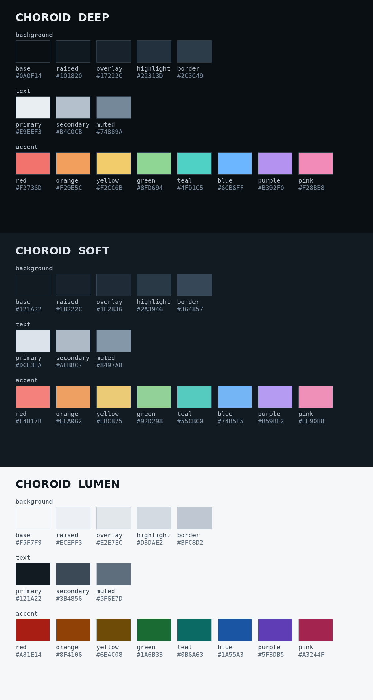

Most popular editor themes—from Gruvbox and Dracula to Solarized and One Dark—share a common origin: they were selected for personal aesthetic preference, nostalgic warm-tinted analog vibes, or arbitrary contrast rules. Few, if any, were engineered with an understanding of human visual neurobiology, retinal receptive fields, or the optical mechanisms that trigger progressive axial myopia.

Yet, real-world development happens across extreme lighting environments: late-night programming under dim incandescent bulbs, or daytime engineering at a desk directly beside a sunlit window where ambient reflections wash across the glass monitor panel.

Worse, standard IDE syntax highlighting forces the human eye into an optical trap. By painting adjacent tokens in saturated primary colors—deep electric blue beside vivid crimson—standard themes subject the fovea to intense **longitudinal chromatic aberration (LCA)**, while character-by-character contrast spikes force continuous, exhausting contrast-gain readjustments.

In 2018, visual neuroscientists Andrea Aleman, Min Wang, and Frank Schaeffel published a landmark paper in *Scientific Reports* (Nature Publishing Group): **"Reading and Myopia: Contrast Polarity Matters"** ([DOI: 10.1038/s41598-018-28904-x](https://doi.org/10.1038/s41598-018-28904-x)). Follow-up research through 2025—including Swiatczak & Schaeffel (2022), Ingrassia et al. (2024), and Schaeffel's 2025 ZEISS Young Investigator Award lecture—has uncovered critical nuances regarding text size thresholds, full-spectrum requirements, and ocular fatigue.

Here is the science behind why conventional themes strain your eyes, and how we engineered **Nature** (featuring the **Choroid v4.0** architecture)—a theme system designed from the retina outward.



---

## 1. The Retinal Mechanism: ON vs. OFF Pathways

The primate retina does not transmit raw pixel luminance to the visual cortex. Instead, visual processing begins in retinal ganglion cells organized into two antagonistic parallel pathways:

1. **ON-Pathway Ganglion Cells:** Receptive fields featuring an excitatory center and inhibitory surround (ON-center / OFF-surround). These cells fire when the center pixel is brighter than the surrounding area (**positive contrast**).
2. **OFF-Pathway Ganglion Cells:** Receptive fields featuring an inhibitory center and excitatory surround (OFF-center / ON-surround). These cells fire when dark strokes are surrounded by a brighter background (**negative contrast**).

Homogeneously illuminated areas of a screen do not stimulate ganglion cells. They respond exclusively to spatial contrast boundaries at the high Fourier spatial frequencies characteristic of typography.

```
       ON Receptive Field                  OFF Receptive Field
     (Bright Text on Dark)                (Dark Text on Bright)

      [ - ] [ - ] [ - ]                    [ + ] [ + ] [ + ]
      [ - ] [ + ] [ - ]                    [ + ] [ - ] [ + ]
      [ - ] [ - ] [ - ]                    [ + ] [ + ] [ + ]

     Center: Excitatory (+)               Center: Inhibitory (-)
     Surround: Inhibitory (-)             Surround: Excitatory (+)
```

### The Natural World vs. The Printed Page

Using custom real-time video Fourier decomposition, Aleman et al. measured the relative ON and OFF stimulus strengths across natural environments (canopies, fields, forest floors, outdoor paths). They discovered that **in natural environments, ON and OFF inputs are balanced in an approximate 1:1 equilibrium**. The visual system evolved to function in an ecology where light and dark stimuli activate both channels symmetrically.

Artificial reading environments break this equilibrium:
- **Black text on white paper/screen** creates an extreme, continuous overstimulation of the **retinal OFF pathway**.
- **White text on dark screen** selectively activates the **retinal ON pathway**.

---

## 2. Optical Coherence Tomography (OCT) & Axial Elongation

To determine whether contrast polarity causally alters ocular physiology, the researchers placed young human subjects in front of brightness-matched displays ($35\text{ cd/m}^2$) and measured their **subfoveal choroidal thickness** using high-resolution Spectral Domain Optical Coherence Tomography (OCT) before, during, and after 60 minutes of reading.

The choroid is the heavily vascularized layer situated directly behind the retina. In optical biometry, choroidal thickness is the primary predictive biomarker of eye growth:
- **Choroidal Thinning:** Precursor to scleral matrix remodeling, tissue stretching, and **axial elongation (myopia progression)**.
- **Choroidal Thickening:** Physical and biochemical buffer that inhibits axial eye growth and promotes **emmetropization (myopia suppression)**.

The empirical results were striking:

| Reading Condition | 60-Minute Subfoveal Choroid Change | Statistical Significance | Biological Consequence |
| :--- | :---: | :---: | :--- |
| **Black Text on White** (OFF Stimulus) | **$-16.13 \pm 4.54\ \mu\text{m}$** (Thinner) | $p = 8.3 \times 10^{-5}$ | Stimulates axial eye growth (myopia progression) |
| **White Text on Black** (ON Stimulus) | **$+9.96 \pm 6.51\ \mu\text{m}$** (Thicker) | $p = 0.0067$ | Inhibits axial eye growth (protective buffering) |

In only 60 minutes of conventional black-on-white reading, the choroid shrank by an average of $16\ \mu\text{m}$. In myopic subjects, this thinning was even more pronounced, governed by the regression formula:

$$\text{Choroidal Thinning } [\mu\text{m}] = 1.44 \times (\text{Refractive Error}) - 11.8\quad (R = 0.71,\ p < 0.001)$$

Conversely, reading bright text on a dark background stimulated the ON pathway, triggering a rapid $+10\ \mu\text{m}$ thickening.

### Cross-Species Evidence and Pattern ERGs

These findings are corroborated across animal and human neurophysiology:
- **Chick and Tree Shrew Studies:** Animal model studies (*Wang 2019*, *Liu 2024*) demonstrated that positive contrast polarity reliably inhibits lens-induced axial elongation and increases retinal dopamine turnover—the primary retinal stop signal for scleral elongation.
- **Pattern Electroretinograms (PERG):** Studies by *Wagner & Strasser (2023, 2025)* showed marked amplitude differences in retinal ganglion cell electrophysiology between emmetropes and myopes under varying polarity conditions, confirming that the ON-pathway response is physiologically dampened in progressing myopes unless stimulated with sufficient optical contrast.

---

## 3. The Critical Text Size Threshold: The ~34 Arcmin Rule

A groundbreaking follow-up investigation (*Swiatczak & Schaeffel 2022, TVST*; *Schaeffel 2025 ZEISS Young Investigator lecture*) revealed a crucial caveat: **inverted contrast only triggers eye shortening when the text is sufficiently large**.

In the 2022 clinical trials:
- **Large text** (capital letter height $\sim 34.4\text{ arcmin}$) triggered statistically significant axial eye shortening.
- **Small text** ($\sim 13.75\text{ arcmin}$, identical to standard unmagnified smartphone text viewed at 30 cm) produced **no statistically significant effect** ($p = 0.09$).

```
       Small Text (~14 arcmin)              Large Text (~34 arcmin)
      ┌─────────────────────────┐         ┌─────────────────────────┐
      │   Standard phone text   │         │    Calibrated text      │
      │   High spatial freq     │         │    Optimal ON-stimulus  │
      │   No axial shortening   │         │    Significant axial    │
      │   p = 0.09 (Fail)       │         │    shortening (Success) │
      └─────────────────────────┘         └─────────────────────────┘
```

Why does text size dictate the response? When typography is too small, the spatial frequency exceeds the receptive field center of foveal ON-ganglion cells. Instead of clear positive-contrast boundaries, the retinal receptive field integrates the text strokes into a low-contrast blur.

To maintain the required $\sim 34\text{ arcmin}$ visual angle, font sizes must scale dynamically with physical viewing distance:

| Viewing Distance | Cap Height Visual Angle | CSS Font Size | Device Context |
| :---: | :---: | :---: | :--- |
| **30 cm** | $\sim 34\text{ arcmin}$ | `16px` | Handheld smartphone (minimum safe distance) |
| **35 cm** | $\sim 34\text{ arcmin}$ | `19px` | Relaxed smartphone viewing |
| **40 cm** | $\sim 34\text{ arcmin}$ | `22px` | **Preferred reading distance** (tablets, close laptops) |
| **50 cm** | $\sim 34\text{ arcmin}$ | `27px` | Standard laptop distance on desk |
| **60 cm** | $\sim 34\text{ arcmin}$ | `32px` | Standard external desktop monitor (24″–27″) |
| **70 cm** | $\sim 34\text{ arcmin}$ | `38px` | Large or deep workstation monitor |

Our site provides a calibrated distance toolbar directly above all documentation and blog articles, allowing you to select your physical viewing distance with a single click.

---

## 4. Why Red/Amber Night Filters Fail: The Ingrassia 2024 Discovery

Many software engineers run amber, sepia, or crimson screen filters (such as f.lux or "Night Shift" on maximum warm tint) during extended coding sessions. While reducing circadian blue light before sleep is valuable for sleep hygiene, **using red-only filters for active reading has severe negative consequences for myopia**:

- *Ingrassia, Swiatczak, & Schaeffel (2024, Vision Research)* investigated the physiological effect of red-in-focus reading filters.
- They discovered that **red-filtered reading paradoxically triggered axial eye lengthening** in emmetropic subjects.
- By stripping out blue and green wavelengths, red filters eliminate the high-frequency luminance detail processed by the retina. Furthermore, longitudinal chromatic aberration causes red wavelengths to focus *behind* the retina (hyperopic defocus), signaling the sclera to elongate toward the red focal plane.

**The Solution:** Body text must remain **neutral, full-spectrum white/gray** (`#E9EEF3` / `#DCE3EA`). This ensures all cone photoreceptor classes (L, M, and S) remain stimulated and longitudinal chromatic aberration is balanced across the fovea.

---

## 5. Visual Fatigue Under Dark Mode: Red Strictly Reserved for Errors

A comprehensive 2024 study published in *Sensors* examined subjective visual fatigue and objective pupil micro-fluctuations across different text colors under dark mode:
- **Red text produced the highest visual fatigue** of all tested hues.
- **Teal and yellow text produced the least visual fatigue**, maintaining high legibility with minimal accommodative fluctuation.

For this reason, the Choroid architecture strictly reserves red (`#F2736D` in Deep, `#F4817B` in Soft, `#A81E14` in Lumen) for critical compiler errors, diagnostics, and warnings. High-frequency syntax elements (such as HTML tags, function names, and attributes) utilize pink (`#F28BB8` / `#EE90B8`), amber-orange (`#F29E5C` / `#EEA062`), teal (`#4FD1C5` / `#55CBC0`), and soft blue (`#6CB6FF` / `#74B5F5`).

---

## 6. Three Calibrated Variants: Deep, Soft, and Lumen

Nature provides three distinct variants to match specific ocular conditions, visual acuities, and ambient light levels:

```
┌────────────────────────────────────────────────────────────────────────┐
│                        CHOROID v4.0 VARIANTS                           │
├───────────────┬────────────────────────────┬───────────────────────────┤
│ Deep (16.5:1) │ #0A0F14 base / #E9EEF3 ink │ Max contrast baseline     │
│               │ Full ON-pathway excitation │ Myopia-informed           │
├───────────────┼────────────────────────────┼───────────────────────────┤
│ Soft (13.6:1) │ #121A22 base / #DCE3EA ink │ Reduced glare & halation  │
│               │ Astigmatism-friendly       │ Myopia-informed           │
├───────────────┼────────────────────────────┼───────────────────────────┤
│ Lumen (16.3:1)│ #F5F7F9 base / #121A22 ink │ Daylight & older eyes     │
│               │ Diffuse high-ambient mode  │ NOT myopia-informed       │
└───────────────┴────────────────────────────┴───────────────────────────┘
```

### 1. Deep Variant (Biological Baseline)
- **Base Background:** `#0A0F14`
- **Raised Surface:** `#101820`
- **Primary Ink:** `#E9EEF3` (16.5:1 contrast ratio)
- **Ocular Target:** Maximum ON-ganglion cell stimulation. Ideal for users with full optical correction and dark or controlled-lighting environments.

### 2. Soft Variant (Astigmatism & Halation Reduction)
- **Base Background:** `#121A22`
- **Raised Surface:** `#18222C`
- **Primary Ink:** `#DCE3EA` (13.6:1 contrast ratio)
- **Ocular Target:** Resolves optical halation (the "glow" or fuzzy edge effect around bright characters on dark backgrounds). Ideal for developers with uncorrected cylinder/astigmatism, dry eye syndrome, or light sensitivity.

### 3. Lumen Variant (Daylight & Proofreading Fallback)
- **Base Background:** `#F5F7F9`
- **Raised Surface:** `#ECEFF3`
- **Primary Ink:** `#121A22` (16.3:1 contrast ratio)
- **Ocular Target:** Designed for high-glare daytime workstations adjacent to sunlit windows, detailed proofreading, and older eyes experiencing lens scatter.
- **Important Disclosure:** Lumen is a standard negative-contrast mode and is **explicitly NOT myopia-informed**.

---

## 7. Screen-Time & Pseudomyopia Protocol

Grounded in International Myopia Institute (IMI 2023, 2025) guidelines and clinical pediatric trials:

| Parameter | Clinical Protocol | Neurobiological Rationale |
| :--- | :--- | :--- |
| **Viewing Distance** | $\ge 30\text{ cm}$ ($\mathbf{40\text{ cm}}$ preferred) | Near work under 30 cm is an independent clinical risk factor for rapid axial elongation. |
| **Continuous Reading** | $\le 30\text{ minutes}$ | Continuous near work over 30–45 min induces ciliary spasm and accommodative lag. |
| **Distance Break** | $\ge 5\text{ minutes}$ | Relax ciliary tonus by viewing distant outdoor objects with high spatial frequency. |
| **Ambient Room Light** | $500\text{ to }1000\text{ lux}$ | **Avoid reading dark themes in pitch-black rooms.** 500–1000 lux ambient lighting thickens the choroid. |
| **Outdoor Sunlight** | $\sim 2\text{ hours / day}$ | The single most clinically effective protective factor for children and adolescents. |
| **Screen Brightness** | Moderate ($35\text{–}85\text{ cd/m}^2$) | Matches the calibrated luminance levels from the Aleman (2018) OCT trials. |
| **Children Under 3** | Zero screen time | Adheres to WHO, AAP, and China Ministry of Education (2025) directives. |

---

## 8. Age-Specific Guidance

| Age Group | Clinical Priority & Recommendations | Variant Selection |
| :--- | :--- | :--- |
| **Children (Ages 3–12)** | Outdoor sunlight ($\sim 2\text{ h/day}$), distance $\ge 30\text{ cm}$, regular breaks. Dark mode benefit is unproven in children. | Deep or Soft with large text (`19px`–`22px`) as an optional supplement. |
| **Teens & Young Adults (Ages 13–25)** | **Highest-risk cohort for adult-onset progression** (students, software engineers). Distance breaks, outdoor time, enlarged text. | **Deep** or **Soft** baseline. |
| **Adults (Ages 25–40)** | Axial elongation generally stabilizes ($< 0.10\text{ D/yr}$). Benefit of inverted contrast is uncertain; prioritize ocular comfort. | **Soft** (low glare) or **Lumen**. |
| **Adults (Ages 40–60)** | Accommodative amplitude diminishes (presbyopia); check astigmatism correction first. | **Soft** or **Lumen** (high legibility). |
| **Adults (60+ Years)** | Lens scatter, pupil miosis, cataract or AMD can flip contrast preferences. Choose purely by legibility. | **Soft** or **Lumen** based on comfort. |

---

## 9. Clinical Caveats & Accommodative Spasm (Pseudomyopia)

> [!IMPORTANT]
> **Design Rationale, Not Medical Treatment:**
> The Nature / Choroid color palette and viewing distance presets are ergonomic design tools based on short-term laboratory optical coherence tomography (OCT) findings. They are not medical treatments, do not cure refractive errors, and are not guaranteed to prevent myopia.

> [!WARNING]
> **Accommodative Spasm ("Pseudomyopia"):**
> If your distance vision becomes blurry following prolonged computer work and recovers over minutes to hours, or if near work is accompanied by frontal headaches and eyestrain, you may be experiencing **ciliary accommodative spasm (pseudomyopia)**.
> 
> A color palette cannot treat or release accommodative spasm. Pseudomyopia requires a comprehensive eye examination by an optometrist or ophthalmologist, typically including **cycloplegic refraction** (eye drops that temporarily relax the ciliary muscle).

---

## 10. Download & Installation

The complete Nature theme is freely available under the MIT license across all major environments:

- [**nature-vscode.json**](/assets/themes/nature-vscode.json) — Complete VS Code theme with full syntax scopes.
- [**nature.nvim**](/assets/themes/nature.nvim) — Standalone Neovim Lua module supporting `deep`, `soft`, and `lumen`.
- [**nature-alacritty.toml**](/assets/themes/nature-alacritty.toml) — Modern Alacritty terminal configuration.
- [**nature.css**](/assets/themes/nature.css) — Web design tokens and reading distance classes.
- [**nature.json**](/assets/themes/nature.json) — Full machine-readable specification.
- [**choroid.json**](/assets/themes/choroid.json) — Reference Choroid v4.0 specification.
- [**choroid.css**](/assets/themes/choroid.css) — Reference Choroid CSS tokens.

---

## 11. Experience Nature Live on This Site

- **Cycle Variants:** Click the theme toggle button in the header (or press **`T`** anywhere on your keyboard) to cycle between **Deep &rarr; Soft &rarr; Lumen &rarr; Deep**.
- **Calibrate Reading Size:** Use the distance buttons (`30cm`, `40cm`, `50cm`, `60cm`) above the article header to match your physical display distance to the $\sim 34\text{ arcmin}$ cap height threshold.
